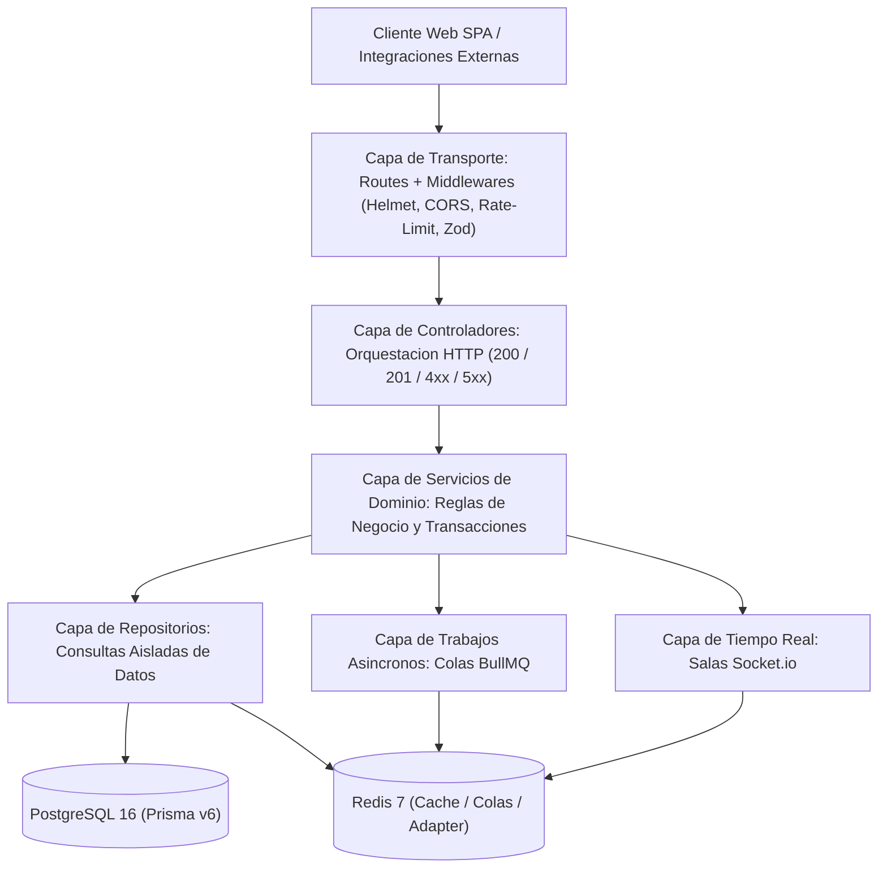

# CRM Comercial Empresarial - Servidor Backend (`crm-empresarial-backend`)

Servidor API RESTful, motor de colas asincronas y pasarela de eventos en tiempo real disenado para la operacion comercial centralizada de una empresa en Guatemala (`America/Guatemala`), construido sobre **Node.js 20+**, **TypeScript Estricto**, **Express 5**, **Prisma 6 (PostgreSQL 16)**, **BullMQ (Redis 7)** y **Socket.io**.

---

## 1. Arquitectura Cliente-Servidor en N-Capas (3-Tier)

El sistema implementa una separacion estricta de responsabilidades con flujo unidireccional de dependencias (vease `docs/adr/ADR-001-arquitectura-cliente-servidor-n-capas.md`):



### Reglas de Frontera Inquebrantables
1. **Rutas y Middlewares (`src/routes/`, `src/middlewares/`):** Validan protocolo HTTP, limites de tasa, trazabilidad (`X-Request-Id`), cabeceras de seguridad y esquemas `Zod`.
2. **Controladores (`src/controllers/`):** Traducen objetos HTTP a llamadas de servicio y emiten codigos de estado HTTP. Prohibido importar `PrismaClient` o escribir reglas comerciales.
3. **Servicios (`src/services/`):** Contienen la logica de negocio, normalizacion telefonica (`+502`), proteccion de embudo (**CRM = Fuente de Verdad**) y coordinacion de colas/eventos. Prohibido acoplarse a `req` o `res` de Express.
4. **Repositorios (`src/repositories/`):** Unica capa autorizada para interactuar con `PrismaClient` y comandos directos de persistencia/infraestructura.

---

## 2. Estructura de Directorios

```text
crm-empresarial-backend/
├── .github/
│   └── PULL_REQUEST_TEMPLATE.md           # Checklist oficial de los 9 pilares y DoD
├── docs/
│   ├── adr/
│   │   ├── ADR-001-arquitectura-cliente-servidor-n-capas.md
│   │   ├── ADR-002-ingesta-omnicanal-asincrona.md
│   │   └── ADR-003-tiempo-real-y-whatsapp.md
│   └── templates/
│       └── plantilla_importacion_leads_gt.csv
├── integrations/
│   └── google-sheets/
│       └── Code.gs                        # Conector Google Apps Script (X-Integration-Key)
├── prisma/
│   └── schema.prisma                      # Esquema relacional PostgreSQL 16 (Prisma v6)
├── src/
│   ├── config/
│   │   ├── cors.ts                        # Lista blanca estricta de origenes CORS
│   │   ├── database.ts                    # Singleton PrismaClient + desconexion limpia
│   │   ├── env.ts                         # Validacion Zod en arranque + kill-switch prod
│   │   ├── helmet.ts                      # Cabeceras HTTP de seguridad (CSP, HSTS, Frame)
│   │   ├── redis.ts                       # Conexion verificada ioredis + apagado limpio
│   │   └── swagger.ts                     # Generador OpenAPI 3.1 (/api/docs y /api/docs.json)
│   ├── controllers/
│   │   └── health.controller.ts           # Controlador HTTP de salud (200 / 503)
│   ├── jobs/
│   │   ├── index.ts                       # Registro tipado de colas BullMQ
│   │   └── README.md                      # Contrato arquitectonico de workers asincronos
│   ├── middlewares/
│   │   ├── error-handler.middleware.ts    # Manejador centralizado de errores y 404
│   │   ├── rate-limit.middleware.ts       # Proteccion contra abuso y fuerza bruta
│   │   ├── request-id.middleware.ts       # Correlacion X-Request-Id por peticion
│   │   └── validate-zod.middleware.ts     # Validacion declarativa body / query / params
│   ├── realtime/
│   │   ├── index.ts                       # Convencion de salas user:{id} y role:admin
│   │   └── README.md                      # Contrato arquitectonico de Socket.io
│   ├── repositories/
│   │   └── health.repository.ts           # SELECT 1 real en PG y PING real en Redis
│   ├── routes/
│   │   ├── health.routes.ts               # Endpoint GET /api/v1/health
│   │   └── index.ts                       # Enrutador raiz /api/v1
│   ├── services/
│   │   └── health.service.ts              # Consolidacion de salud y hora America/Guatemala
│   ├── utils/
│   │   ├── app-error.ts                   # Jerarquia tipada AppError (400..503)
│   │   └── logger.ts                      # Pino estructurado con redaccion de secretos
│   ├── app.ts                             # Ensamblaje del pipeline Express 5
│   └── server.ts                          # Bootstrap HTTP + Graceful Shutdown
├── tests/
│   └── integration/
│       └── health.test.ts                 # Suite de integracion real (Vitest + Supertest)
├── .editorconfig
├── .env.example
├── .gitignore
├── .npmrc
├── docker-compose.yml
├── eslint.config.mjs
├── package.json
├── tsconfig.build.json
├── tsconfig.json
└── vitest.config.ts
```

---

## 3. Matriz de los 9 Pilares Tecnicos

| # | Pilar de Ingenieria | Implementacion en el Servidor | Evidencia en Codigo / Documentos |
| :- | :--- | :--- | :--- |
| 1 | **Arquitectura en N-Capas** | Separacion estricta `routes -> controllers -> services -> repositories` + capas `jobs` y `realtime` | `src/`, `docs/adr/ADR-001-arquitectura-cliente-servidor-n-capas.md` |
| 2 | **Tipado Estricto TypeScript** | `strict: true`, `noUncheckedIndexedAccess: true`, `noImplicitOverride: true` y prohibicion absoluta de `any` | `tsconfig.json`, `eslint.config.mjs` |
| 3 | **Contratos Validados y Documentados** | Validacion de entrada y entorno con `Zod v4` sincronizada con especificacion **OpenAPI 3.1.0** | `src/config/env.ts`, `src/middlewares/validate-zod.middleware.ts`, `src/config/swagger.ts` |
| 4 | **Ciberseguridad Aplicativa** | Cabeceras `Helmet`, lista blanca `CORS`, `express-rate-limit`, ocultamiento de `X-Powered-By` y kill-switch de Sandbox en produccion | `src/config/helmet.ts`, `src/config/cors.ts`, `src/middlewares/rate-limit.middleware.ts` |
| 5 | **Persistencia Relacional Robusta** | **PostgreSQL 16** gobernado por **Prisma ORM v6** con `DATABASE_URL` / `DIRECT_URL` y zona horaria `America/Guatemala` | `docker-compose.yml`, `prisma/schema.prisma`, `src/config/database.ts` |
| 6 | **Asincronia y Tiempo Real** | Infraestructura lista con **Redis 7** (`appendonly yes`), **BullMQ** y salas segmentadas **Socket.io** (`user:{id}`, `role:admin`) | `src/config/redis.ts`, `src/jobs/`, `src/realtime/`, `docs/adr/ADR-003-tiempo-real-y-whatsapp.md` |
| 7 | **Ingesta Omnicanal Gobernada** | Regla **CRM = Fuente de Verdad** para Bot Webhook, Google Sheets (`Code.gs`), Excel (`exceljs`) y CSV (`csv-parse`) con `+502` | `docs/adr/ADR-002-ingesta-omnicanal-asincrona.md`, `integrations/google-sheets/Code.gs`, `docs/templates/plantilla_importacion_leads_gt.csv` |
| 8 | **Observabilidad y Errores Estandar** | Sobre uniforme `{ success: false, error: { code, message, requestId } }` y logs JSON `pino` con redaccion automatica de secretos | `src/utils/app-error.ts`, `src/utils/logger.ts`, `src/middlewares/error-handler.middleware.ts` |
| 9 | **Calidad, Pruebas y Cadena de Suministro** | Pruebas de integracion reales con `Vitest + Supertest`, `engine-strict=true` y auditoria de CVEs en dependencias productivas | `tests/integration/health.test.ts`, `.npmrc`, `package.json`, `.github/PULL_REQUEST_TEMPLATE.md` |

---

## 4. Puesta en Marcha Local

### 4.1 Requisitos Previos
- **Node.js** `>= 20.11.0` y **npm** `>= 10.0.0`
- **Docker Desktop / Docker Engine** con `docker compose` v2+

### 4.2 Configuracion de Variables de Entorno
Copie la plantilla `.env.example` hacia `.env` y ajuste las variables si fuese necesario:

```powershell
Copy-Item .env.example .env
```

### 4.3 Levantar Infraestructura Local (PostgreSQL 16 + Redis 7)
```powershell
docker compose up -d
docker compose ps
```
Ambos contenedores (`crm_empresarial_pg` y `crm_empresarial_redis`) deben reportar estado `healthy`.

### 4.4 Instalar Dependencias y Generar Cliente Prisma
```powershell
npm install
npm run prisma:generate
```

### 4.5 Iniciar Servidor en Modo Desarrollo
```powershell
npm run dev
```
- **Endpoint de salud:** `http://localhost:4000/api/v1/health`
- **Documentacion interactiva Swagger UI:** `http://localhost:4000/api/docs`
- **Especificacion OpenAPI 3.1 JSON:** `http://localhost:4000/api/docs.json`

---

## 5. Comandos de Verificacion y Calidad (Compuerta CI / DoD)

Ejecute la suite completa de validacion antes de abrir cualquier Pull Request:

```powershell
# 1. Analisis estatico ESLint (cero errores, cero explicit any)
npm run lint

# 2. Verificacion estricta del compilador TypeScript
npm run typecheck

# 3. Pruebas de integracion reales contra PostgreSQL y Redis (Vitest + Supertest)
npm run test

# 4. Compilacion de artefacto productivo en dist/
npm run build

# 5. Auditoria de seguridad en dependencias de produccion
npm audit --omit=dev --audit-level=high
```
